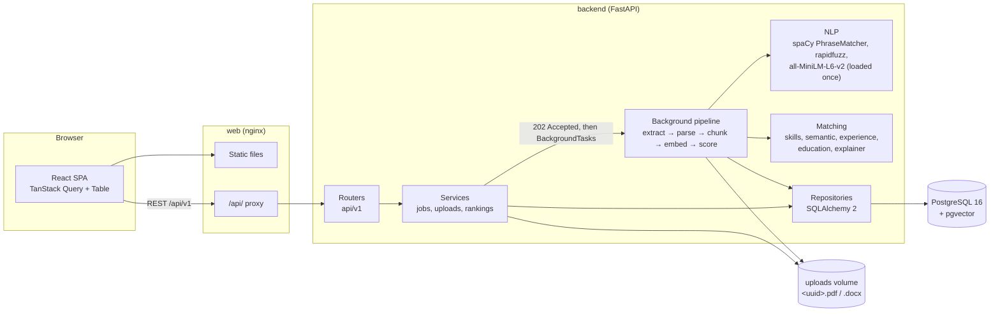
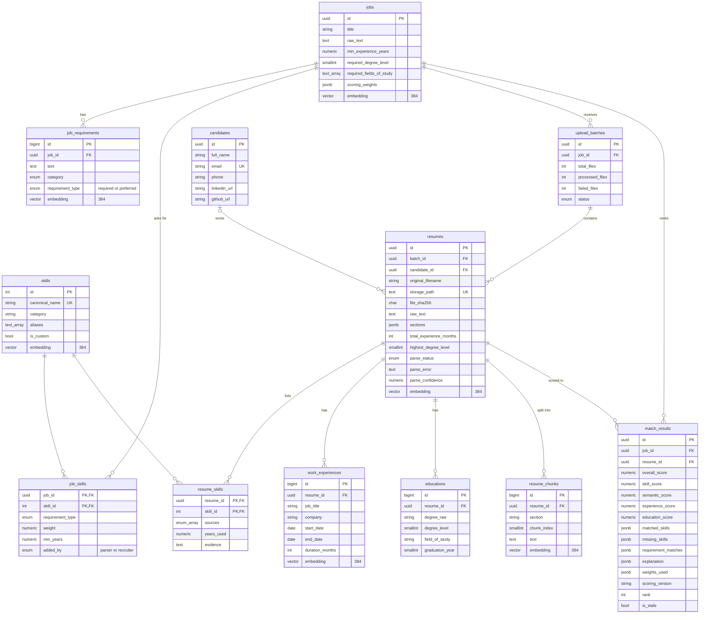

# AI Resume Matcher

[](https://github.com/DakshDave23/AI-Resume-Matching/actions/workflows/ci.yml)

Rank a batch of PDF/DOCX resumes against a job description and explain every point of every score.

Each resume gets a 0–100 match score built from four explainable components: **skills**, **semantic similarity**, **relevant experience** and **education**. Scoring is deterministic: the same inputs always give the same score, and every point traces back to a rule and a piece of evidence from the resume. Everything runs locally on a laptop CPU, with no paid API and no LLM in the score.

> **Data notice:** all resumes and job descriptions in this repository are synthetic. No real person's data is used.

---

## Contents

1. [Demo](#demo)
2. [Features](#features)
3. [Quick start](#quick-start)
4. [A tour of the app](#a-tour-of-the-app)
5. [Architecture](#architecture)
6. [Tech stack](#tech-stack)
7. [Local development](#local-development)
8. [Sample data](#sample-data)
9. [How parsing works](#how-parsing-works)
10. [How matching works](#how-matching-works)
11. [Database](#database)
12. [API](#api)
13. [Results](#results)
14. [Project structure](#project-structure)
15. [Running tests](#running-tests)
16. [Limitations and future work](#limitations-and-future-work)
17. [Data and ethics](#data-and-ethics)
18. [License](#license)

## Demo

_TODO: screenshots and demo video link._

## Features

- **Job description intake:** paste or upload a JD (TXT, PDF or DOCX). Required and preferred skills, minimum years, degree and fields of study are extracted and shown as editable chips, so the recruiter fixes any extraction error before matching.
- **Batch resume parsing:** upload up to 50 PDF/DOCX resumes at once and watch each one parse live. Name, contact details, skills, work history, total and relevant years, and education are extracted; a file that can't be read says why.
- **Semantic matching:** tiered skill matching (exact → alias → related → inferred from experience) plus requirement-level sentence-embedding similarity, so candidates match on meaning, not just keywords.
- **Ranking dashboard:** summary cards, a sortable and filterable table, weight sliders that re-rank instantly, and CSV export.
- **Explanations:** every candidate page shows the points earned and lost per component, the top strengths and gaps with their resume evidence, and the best resume sentence for each JD requirement.
- **One command to run:** `docker compose up` starts the database, the API and the web app, with the embedding model baked into the image and a "Load sample data" button for the demo.

## Quick start

Needs Docker (Docker Desktop on Windows and macOS) and about 4 GB of free disk space.

```bash
git clone https://github.com/DakshDave23/AI-Resume-Matching.git
cd AI-Resume-Matching
cp .env.example .env          # Windows: copy .env.example .env
docker compose up --build     # or: make up
```

Open **http://localhost:8080** and click **Load sample data**. The 15 sample resumes parse live, then "Next: see the rankings" opens the ranked table. The API's docs are at http://localhost:8000/docs.

- **First build:** a few minutes. It downloads Python, CPU-only PyTorch and the embedding model; the model is baked into the image, so the containers never download anything.
- **Each start:** the backend applies the database migrations and seeds the skills taxonomy (both safe to re-run). The model then loads in a few seconds; until then the header says "Model loading…".
- **Services:** `db` (Postgres 16 + pgvector), `backend` (FastAPI, one worker) and `web` (nginx serving the app and forwarding `/api/` to the backend, so the browser uses one origin). All ports are bound to 127.0.0.1. Set `WEB_PORT`, `API_PORT` or `POSTGRES_PORT` in `.env` to move them (for example if a local Postgres already uses 5432).
- **Data:** the database and the uploaded files live in the `pgdata` and `uploads` volumes. `docker compose down` keeps them; `docker compose down -v` deletes them.

## A tour of the app

The app is a three-step wizard (Job → Resumes → Results) plus a page per candidate.

1. **Jobs** (`/`): every job with its created date, resume count and top match. With no jobs yet it offers "New job" and "Load sample data".
2. **Job description** (`/jobs/new`, then `/jobs/:jobId`): paste the JD or upload a file, then review what was extracted. Click a skill chip to move it between Required and Preferred, × to remove it, or "+ Add skill" with autocomplete (aliases work: `k8s` finds Kubernetes). Years, degree and fields are editable too. Saving marks any existing scores as stale.
3. **Upload resumes** (`/jobs/:jobId/upload`): drop up to 50 PDF/DOCX files of at most 5 MB each. Files that can't be sent are listed with the reason before anything is uploaded. Each file then goes queued → parsing → parsed, or failed with its reason (a scanned PDF says "Looks like a scanned image; OCR is not enabled."). The page polls every 2 seconds, and the batch id is kept in the URL, so a reload keeps showing the progress.
4. **Rankings** (`/jobs/:jobId/rankings`):
   - Summary cards: resumes ranked, average match, top match, and how many have every required skill.
   - The table: rank, name and title, total and relevant years, match % as a bar with its verdict word, the first matched skills, missing required skills and parse quality. Click a column header to sort.
   - Filters: search, minimum match, and "Has skill".
   - **Weights:** one slider per component. The table re-ranks instantly in the browser from the stored component scores (each row shows how far it moved); "Save weights" re-scores on the server, "Reset to defaults" goes back to 40/30/20/10.
   - **Export CSV** with the current filters.
   - Resumes that couldn't be ranked are listed with their reason, and a banner offers "Re-score now" after the requirements change.
5. **Candidate** (`/jobs/:jobId/candidates/:resumeId`): contact details and a parse-confidence badge, a score gauge with the verdict, and a breakdown bar per component (the earned points add up to the match %). The tabs:
   - **Overview:** top strengths and gaps, each with its points and resume snippet.
   - **Skills:** matched skills with their tier (Exact, Alias, Related, Inferred; evidence on hover), then missing required and preferred skills.
   - **Experience:** required vs total vs relevant years, and each role's relevance factor.
   - **Requirements:** each JD requirement, the closest resume sentence, its similarity and status.
   - **Education:** what the JD asks for, what the resume has, and how it was scored.
   - **Resume:** the extracted text with matched skills highlighted, and a link to the original file.

   Previous and Next move through the ranking.

Loading shows skeletons, empty pages say what to do next, a page that can't load offers "Try again", and a failed action shows a toast with the API's message. Colour is never the only signal: every score has its verdict word and every missing skill an icon.

## Architecture



**What happens to an upload**

1. The JD is parsed into skills, years, degree and requirement sentences; each sentence is embedded; the recruiter reviews and edits the result.
2. Resumes are checked on arrival (real file type, size, duplicates), stored under UUID names, and the API answers `202 Accepted` with a batch id at once.
3. A background task handles each resume in its own transaction: extract text → clean → split into sections → parse → chunk → embed → save → score against the job. A bad file is marked `failed` with a reason and never stops the batch.
4. The frontend polls the batch every 2 seconds. The dashboard and candidate pages only read stored results; nothing is recomputed when a page opens.
5. Changing the weights needs no NLP: component scores are stored, so the browser previews the new ranking instantly and `PATCH /weights` saves it.

**Design choices**

- **Deterministic hybrid scoring, not an LLM.** The same inputs always give the same score, and each point comes from a rule a recruiter can check. No resume text leaves the machine.
- **One store.** PostgreSQL holds the relational data, the JSONB analysis snapshots and the 384-dimensional vectors (pgvector), so there is no separate vector database to keep in sync.
- **BackgroundTasks, not Celery.** A batch of 50 resumes finishes in seconds, so a queue would add containers without adding value. The pipeline is one function ([`services/pipeline.py`](backend/app/services/pipeline.py)); moving it to a queue later changes one file. If the server stops mid-batch, it finishes the remaining files when it starts again.
- **Layers:** routers ([`api/v1/`](backend/app/api/v1/)) validate and shape HTTP; services hold the logic; repositories ([`repositories/`](backend/app/repositories/)) own every query; the NLP and matching code is pure Python that tests call directly.
- **Recruiter in the loop.** Extraction errors are fixed on the requirement chips before scoring, which is cheaper than making the parser perfect.

## Tech stack

| Layer | Choice | Why |
| --- | --- | --- |
| Frontend | React 18, TypeScript, Vite | TypeScript catches API-shape bugs; Vite starts in seconds; no server rendering needed |
| UI | Tailwind CSS, shadcn/ui (Radix), lucide icons | Accessible tabs, badges and buttons that look finished, without a heavy component library |
| Server state | TanStack Query | Caching, plus `refetchInterval` polling for parse status |
| Ranking table | TanStack Table | Headless sorting over the API's rows, with full control of the markup |
| Upload, toasts | react-dropzone, sonner | Multi-file drag and drop with type filtering; small, accessible toasts |
| API types | openapi-typescript | Frontend types generated from the backend's OpenAPI schema, so the two can't drift apart (CI checks it) |
| Backend | Python 3.12, FastAPI, Pydantic v2 | Same language as the NLP; typed validation; Swagger UI at `/docs` for free |
| ORM and migrations | SQLAlchemy 2, Alembic, psycopg 3 | Typed models; every schema change is a reviewed, numbered migration |
| Text extraction | PyMuPDF, python-docx | Text blocks with coordinates fix two-column reading order; DOCX tables and headers are read in order |
| Skills and sections | spaCy (blank pipeline + PhraseMatcher), rapidfuzz | Hundreds of skill terms matched in one pass on whole tokens; fuzzy matching catches "Kubernetis" and "Work Experiance" |
| Phones and dates | phonenumbers, a small date grammar | Valid numbers normalised to E.164; dates parsed without guessing missing parts from today |
| Embeddings | sentence-transformers `all-MiniLM-L6-v2` on CPU PyTorch | Small and fast on a CPU, good on short texts; 384 dimensions keep storage light; switchable by env var |
| Database | PostgreSQL 16 + pgvector | Relational joins, JSONB and vectors in one store |
| Quality | pytest, Vitest, ruff, mypy (strict), ESLint, Prettier | Fast feedback on the parser and scorer maths; consistent style |
| DevOps | Docker Compose, nginx, GitHub Actions, Makefile | One command to run; CI on every push |

**Why embeddings rather than TF-IDF or an LLM:** TF-IDF only matches the same surface words, so "built RESTful services" never meets "REST API development". An LLM judge is slower, costs money, can score differently on a rerun and sends candidate data to a third party.

## Local development

For working on the code with hot reload: the database in Docker, the backend and frontend on your machine.

**Requirements:** Docker, Python 3.12, Node 22.12+. `make` is optional (macOS/Linux, or Windows with `winget install ezwinports.make`); every target has a plain command below.

```bash
cp .env.example .env                   # once; Windows: copy .env.example .env
docker compose up -d --wait db         # Postgres 16 + pgvector on 127.0.0.1:5432
```

**Backend** (http://localhost:8000/docs):

```bash
cd backend
py -3.12 -m venv .venv                 # macOS/Linux: python3.12 -m venv .venv
.venv\Scripts\activate                 # macOS/Linux: source .venv/bin/activate
# Linux only, first: pip install torch==2.15.0 --index-url https://download.pytorch.org/whl/cpu
pip install -e ".[dev]"                # includes PyTorch (CPU) for the embedding model
alembic upgrade head                   # create/upgrade the database schema
python ../scripts/seed_skills.py       # load the skills taxonomy and embed each skill
uvicorn app.main:app --reload
```

**Frontend** (http://localhost:5173, in a second terminal):

```bash
cd frontend
npm ci                                 # exact versions from package-lock.json
npm run dev
```

The frontend reads the API address from `VITE_API_BASE_URL` in the repo-root `.env` (default `http://localhost:8000/api/v1`). The header shows the API's state from `/health`: "Model loading…" for the first seconds after the backend starts, then "API ready".

**Make targets** (run `make` to list them all):

| Target | Plain command |
| --- | --- |
| `make up` | `docker compose up --build -d --wait` (everything, on http://localhost:8080) |
| `make down` | `docker compose down` |
| `make logs` | `docker compose logs -f` |
| `make db-up` | `docker compose up -d --wait db` |
| `make db-down` | `docker compose stop db` |
| `make db-reset` | `docker compose down -v` then `make db-up` |
| `make db-shell` | `docker compose exec db psql -U resume -d resume_matcher` |
| `make install` | the backend venv and `pip install -e ".[dev]"` |
| `make migrate` | `cd backend && alembic upgrade head` |
| `make seed` | `backend/.venv/Scripts/python scripts/seed_skills.py` |
| `make dev` | `cd backend && uvicorn app.main:app --reload` |
| `make check` | backend lint, format check, type check and tests |
| `make web-install` | `cd frontend && npm ci` |
| `make web` | `cd frontend && npm run dev` |
| `make web-check` | frontend lint, format check, type check, tests and build |
| `make types` | `backend/.venv/Scripts/python scripts/export_openapi.py`, then `cd frontend && npm run generate:types` |
| `make samples` | `backend/.venv/Scripts/python scripts/generate_samples.py` |
| `make eval-parsing` | `backend/.venv/Scripts/python scripts/evaluate_parsing.py --out docs/parsing-accuracy.md` |
| `make eval-ranking` | `backend/.venv/Scripts/python scripts/evaluate_ranking.py --out docs/ranking-results.md` |

**Embedding model:** `EMBEDDING_MODEL` (default `sentence-transformers/all-MiniLM-L6-v2`, 384 dimensions) is downloaded from Hugging Face on first use (about 90 MB) and read from the local cache after that, so later starts work offline. The API loads it once, in the background, a few seconds after start-up. Until it is ready, `/health` answers 503 and routes that need it answer 503 with `model_loading`. Any other 384-dimensional model works (e.g. `BAAI/bge-small-en-v1.5`); after switching, run `seed_skills.py --reembed` and recalibrate the scoring thresholds.

**Skills taxonomy:** [`backend/app/data/skills_taxonomy.json`](backend/app/data/skills_taxonomy.json) lists ~430 skills in 15 categories, each with aliases (`k8s` → Kubernetes, `postgres` → PostgreSQL). To add a skill, add a line to the file and re-run the seed script. `seed_skills.py --check` validates the file without touching the database and rejects any alias claimed by two skills. The seed script embeds every skill that has no vector yet, as "name (category)", e.g. "Kafka (messaging)".

**Migrations** live in `backend/alembic/versions/` and are numbered. To add one after changing a model:

```bash
alembic revision --autogenerate --rev-id 0004 -m "what changed"
# review the generated file by hand, then:
alembic upgrade head
alembic check                          # "No new upgrade operations detected." = models and DB agree
```

**API types** are generated, never written by hand. After changing a backend route or schema, run `make types`: it writes the OpenAPI schema to `frontend/openapi.json` and regenerates `frontend/src/types/api.ts`, so the frontend's type check catches any mismatch.

**Health check:** `GET /api/v1/health` returns 200 when Postgres, pgvector and the embedding model are all ready, and 503 otherwise. `checks` says which one: `{"database": "ok", "pgvector": "0.8.7", "embedding_model": "ok" | "loading" | "failed"}`.

## Sample data

Everything in [`sample_data/`](sample_data/) is synthetic: invented people and companies, `example.com` emails, and phone numbers from ranges reserved for fiction.

| Path | What it is |
| --- | --- |
| `jds/*.txt` | Three job descriptions: Backend Java Developer (the main demo), Data Scientist, Frontend React Developer |
| `jds/expected.yaml` | What a perfect JD parser would extract from each |
| `personas/NN_*.yaml` | 15 hand-written resume personas, each built to test one thing (aliases, two-column layout, overlapping jobs, keyword stuffing, a scanned PDF, ...) |
| `resumes/` | The personas rendered to PDF and DOCX in one-column, two-column, table and scanned layouts |
| `ground_truth.json` | Expected name, contact, skills, roles, total months, degree level and ranking tier per resume |

The personas are the source; the resumes and ground truth are generated from them:

```bash
backend/.venv/Scripts/python scripts/generate_samples.py --check   # validate personas only
backend/.venv/Scripts/python scripts/generate_samples.py           # re-render (deterministic)
```

The generator refuses to write anything if the ground truth would be incomplete. For example, if a resume mentions a taxonomy skill that its persona doesn't list, it stops with an error.

## How parsing works

Each resume goes through the same steps; the full rules, with examples, are in **[docs/parsing.md](docs/parsing.md)**.

| Step | What it does |
| --- | --- |
| Validate | The content decides the type (`%PDF-`, or a ZIP with `word/document.xml`), not the extension; size and duplicates are checked |
| Extract | PyMuPDF text blocks in column order (two-column resumes don't interleave); DOCX header, paragraphs and tables in order. A PDF with almost no text is reported as scanned |
| Clean | NFKC normalisation, one bullet style, rejoined hyphenated words |
| Sections | Fuzzy-matched headers (~90 known, typos allowed): contact, summary, experience, skills, projects, education, certifications |
| Contact | Email, phone (validated, E.164), LinkedIn, GitHub, name and location from the layout of the contact lines |
| Skills | Taxonomy names and aliases on whole tokens, then a fuzzy pass over the skills list; unmapped items are kept for the recruiter |
| Work history | Each date range anchors a role; overlapping jobs count once in total experience; internships are listed but not counted |
| Education | Degree level (diploma → doctorate), field, institution and year; the highest level is scored |
| Chunks | Each role, project and the summary become a passage; every passage is embedded for requirement matching |

The JD parser uses the same engine and adds required/preferred cues, years per skill, the minimum degree and fields, and one row per requirement sentence. To see what the parser makes of a file:

```bash
cd backend
python -m app.services.parsing ../sample_data/resumes/02_java_aliases.docx
python -m app.services.parsing --jd ../sample_data/jds/backend_java_developer.txt
```

## How matching works

The full method, every threshold with its measurement, and a worked example are in **[docs/matching-algorithm.md](docs/matching-algorithm.md)**.

```
Score = 100 × Σ(wᵢ · Sᵢ) / Σ(wᵢ)   over active components
```

| Component | Sᵢ measures | Default weight |
| --- | --- | --- |
| Skills | Each JD skill (required 1.0, preferred 0.5) earns credit from the first tier that fires: exact or alias 1.0, a related skill of the same category (cosine ≥ 0.58) 0.5, inferred from an experience passage (cosine ≥ 0.43) 0.5, missing 0 | 0.40 |
| Semantic similarity | The best resume passage for each JD requirement sentence, plus whole-document similarity, calibrated on the samples to 0–1 | 0.30 |
| Relevant experience | Months in roles similar to the job (each month counted once, overlapping jobs never twice), against the JD's minimum | 0.20 |
| Education | Degree level against the JD's (1.0 / 0.5 / 0.2), × 0.8 for a different field | 0.10 |

- A component the JD doesn't ask for drops out and the others are rescaled; "or equivalent experience" halves education's weight.
- Ties are broken by required-skill coverage, then relevant years.
- Every result stores its weights and `scoring_version`, and is upserted on (job, resume), so scoring again never duplicates.

**Explanations** are built from the same numbers by fixed templates, with no LLM:

- **Verdict:** 80+ strong, 65–79 good, 50–64 partial, below 50 weak.
- **Breakdown:** points earned against points available per component, adding up to the match % exactly as displayed.
- **Strengths and gaps,** each with its points and the resume evidence behind it.

**Worked example** (sample 3, Candidate A, against the Backend Java JD): skills 4.75 ÷ 6.5 = 0.731 (Microservices inferred, PostgreSQL and Kafka only related, AWS missing), semantic 1.0, relevant experience 4.5 of 4 years = 1.0, education 1.0. That gives **89.2, strong match**, with all 10.8 lost points on skills: −3.1 each for Microservices, PostgreSQL and AWS, and −1.5 for Kafka. This is the design doc's example exactly, and a test checks it with the real model.

**Thresholds were measured, not taken from the doc.** `all-MiniLM-L6-v2` has a narrower similarity range than the design doc assumed (MySQL/PostgreSQL scores 0.62, not 0.80+), so each threshold was set on the samples. The measurements sit next to each value in [`scoring_config.py`](backend/app/services/matching/scoring_config.py).

## Database

PostgreSQL 16 with pgvector. Twelve tables, created by the Alembic migrations in [`backend/alembic/versions/`](backend/alembic/versions/).



- **Snapshots in JSONB.** Matched skills, missing skills, requirement matches and the explanation are always read together and describe one scoring run, so they are JSONB on `match_results`. If the taxonomy changes later, past explanations stay as they were. Each row also stores its `weights_used` and `scoring_version`.
- **One result per job and resume:** a unique (`job_id`, `resume_id`) pair, so re-scoring upserts instead of duplicating. Ranks are assigned in SQL over the whole job.
- **Constraints in the schema:** score ranges, file size and confidence are `CHECK` constraints; skill names are unique case-insensitively; the same file twice in one batch is rejected by a unique (`batch_id`, `file_sha256`) pair.
- **Indexes:** `match_results (job_id, overall_score DESC)` serves the ranking table; `resume_skills (skill_id)` answers "who has Kafka"; a GIN index on `skills.aliases` serves alias lookups. Vectors are compared within one job's handful of rows, so no vector index is needed at this scale.
- **Deletes cascade** from a job to its batches, resumes and results; a skill used by a job or resume can't be deleted.

## API

REST under `/api/v1`. Swagger UI at http://localhost:8000/docs lists every route with its request and response shapes, so it doubles as a demo.

| Method | Path | What it does |
| --- | --- | --- |
| GET | `/health` | Database, pgvector and embedding-model readiness; 503 until all are ready |
| POST | `/jobs` | Create a job from pasted JD text (`{"text": ..., "title": optional}`) |
| POST | `/jobs/upload` | Create a job from a PDF, DOCX or TXT file |
| GET | `/jobs` | List jobs, newest first, with resume count and top score (`limit`, `offset`) |
| GET | `/jobs/{job_id}` | One job: extracted skills (required/preferred, weight, min years, source phrase), requirement sentences, years, degree, fields |
| PATCH | `/jobs/{job_id}/requirements` | Recruiter edits; marks existing scores stale |
| POST | `/jobs/{job_id}/resumes` | Upload 1–50 PDF/DOCX resumes; 202 with the batch id, accepted files and rejected files with reasons |
| GET | `/batches/{batch_id}` | Batch progress for polling: status, parsed / failed / pending counts, and each file's parse status, error, confidence (`needs_review` below 0.5) and candidate name |
| POST | `/jobs/{job_id}/match` | Re-score every parsed resume (optionally saving new `weights` first); 409 if a run is already going |
| GET | `/jobs/{job_id}/rankings` | Ranked candidates: match %, verdict, component scores, years, top skills and matched-skill count, missing required count, parse confidence (`needs_review` below 0.5). Filters: `min_score`, `skill` (an alias works), `search`; `sort` = score, name, relevant_experience, total_experience. `not_ranked` lists the job's resumes still parsing or failed, with the reason |
| GET | `/jobs/{job_id}/rankings/export` | The same rows as CSV (cells that would run as spreadsheet formulas are escaped) |
| GET | `/jobs/{job_id}/candidates/{resume_id}` | The full stored analysis: contact, parse confidence, education entries, extracted text, component scores, matched skills (tier, evidence) and missing skills, requirement matches, explanation (breakdown, strengths, gaps, experience roles, education) |
| GET | `/resumes/{resume_id}/file` | The original uploaded file under its original name (PDFs open in the browser) |
| PATCH | `/jobs/{job_id}/weights` | Save the four weights (each ≥ 0, not all 0) and recompute every total |
| POST | `/sample-data` | The demo: creates the sample Backend Java job and uploads the 15 sample resumes (202, like an upload). Reads `SAMPLE_DATA_DIR`; 404 if the server has none |
| GET | `/skills?q=` | Autocomplete for the requirement chips: exact name or alias first, then names and aliases starting with the text (`k8s` finds Kubernetes) |

**Resume uploads.** Each file is checked on arrival: size, real type (magic bytes, not the extension) and duplicates within the upload. A bad file is listed under `rejected` with a reason, and the rest go ahead. Accepted files are stored as `<uuid>.<ext>` under `UPLOAD_DIR`; the recruiter's file name is kept for display only. A background task then parses each one (extract → parse → chunk → embed → save) in its own transaction, so a failure marks only that file `failed`, with a reason such as "Looks like a scanned image; OCR is not enabled." The 15 samples finish in about 2 seconds on a laptop CPU. If the server stops mid-batch (a crash, or `--reload`), it finishes the remaining files when it starts again.

`PATCH /requirements` changes only the fields sent. `skills` replaces the whole chip list. Each chip names a skill by `skill_id`, or by `name` (canonical or alias: `k8s` finds Kubernetes). An unknown name adds a custom skill. Chips the recruiter changed are saved with `added_by: "recruiter"`.

Every error has the same shape: `{"error": {"code": "...", "message": "...", "details": ...}}`.

| Status | When |
| --- | --- |
| 202 | Upload accepted; parsing continues in the background |
| 409 | A scoring run for the job is already in progress |
| 400 | Empty file |
| 404 | No such job |
| 413 | File over the upload limit |
| 415 | Not a PDF, DOCX or TXT |
| 422 | Invalid body, scanned or corrupt file, unknown skill id, duplicate skill, max years below min |
| 503 | `model_loading` |

## Results

### Parsing accuracy

Measured by `make eval-parsing` on the 14 text samples and 3 JDs against `sample_data/ground_truth.json`. The full report, including every miss, is in [docs/parsing-accuracy.md](docs/parsing-accuracy.md).

| Field | Metric | Result | Target |
| --- | --- | --- | --- |
| Name | Exact match after normalising case and spaces | 100% (14/14) | ≥ 90% |
| Email | Exact match | 100% (14/14) | ≥ 98% |
| Phone | Match after E.164 normalisation | 100% (14/14) | ≥ 95% |
| Skills | Precision, recall and F1 | P 1.00, R 1.00, F1 1.00 (200 skills) | F1 ≥ 0.85 |
| Total experience | Mean absolute error | 0.0 months | ≤ 6 months |
| Degree level | Accuracy | 100% (14/14) | ≥ 90% |
| Sections | Share of sections found | 100% (57/57) | ≥ 90% |
| JD extraction | Required/preferred skills, years, degree, fields | 100% (3/3 JDs) | — |

The scanned PDF (persona 15) is rejected with `scanned_pdf`, as expected. **Read these as an upper bound:** the parsers were developed against these same samples. The parser unit tests cover formats the samples don't have, and real resumes will be messier.

### Ranking quality

Measured by `make eval-ranking`: every text sample scored against every sample JD with the real model. The full report, with each ranking, is in [docs/ranking-results.md](docs/ranking-results.md).

| JD | Spearman (match % vs expected tier) | Precision at k | Last place |
| --- | --- | --- | --- |
| Backend Java | **0.93** (goal ≥ 0.8) | 0.75 (k = 4) | sample 13, the accountant |
| Data Scientist | 0.57 | 1.00 (k = 1) | sample 11 |
| Frontend React | 0.45 | 1.00 (k = 1) | sample 13 |

- **The miss:** for the Java JD, sample 11 ("good": every skill an exact match, but only a diploma) ranks 4th, 2.7 points above sample 3 ("strong": two skills only related, one inferred). Under the default weights the diploma costs 5 points and the indirect skills 10.8. Only raising education's weight to 0.2 would change that. The design doc's 40/30/20/10 were kept rather than tuned to one pair of samples.
- **The other two JDs** each have one strong sample and 12–13 equally "weak" ones, so Spearman there mostly measures the order among the weak. The strong sample ranks first, by 57 points or more.
- **Keyword-only ablation** (semantic weight 0, related and inferred skills off): the keyword stuffer (sample 7) climbs from 11th to 6th. Sample 3, whose skills are partly described rather than listed, loses 15.6 points. Sample 2's synonyms are all in the alias dictionary, so it stays put.
- **Stability:** partial credit at 0.4 or 0.6 instead of 0.5 gives identical rankings. Moving any weight by ±0.1 keeps the same top 3, apart from the order of two candidates 0.5 points apart, and except lowering education, which lets sample 11 into the top 3.
- **Speed:** the 14 readable samples are extracted, parsed, embedded and scored in about 1–4 seconds on a laptop CPU, once the model is loaded.

## Project structure

```text
.
├── backend/
│   ├── app/
│   │   ├── api/v1/          routers: jobs, batches, rankings, resumes, skills, samples, health
│   │   ├── core/            settings, database, error envelope, logging
│   │   ├── data/            skills_taxonomy.json
│   │   ├── models/          SQLAlchemy models
│   │   ├── repositories/    every database query
│   │   ├── schemas/         Pydantic request and response bodies
│   │   └── services/
│   │       ├── extraction/  file validation, PDF and DOCX text
│   │       ├── parsing/     sections, contact, skills, dates, experience, education, JD, chunks
│   │       ├── nlp/         embedder, model loader, taxonomy, spaCy pipeline
│   │       ├── matching/    skill, semantic, experience and education scorers, explainer, config
│   │       └── pipeline.py  the background batch: parse, embed, save, score
│   ├── alembic/             numbered migrations
│   ├── tests/               unit/ (no database) and integration/ (real Postgres)
│   └── Dockerfile
├── frontend/
│   ├── src/
│   │   ├── api/             API client and one module per resource
│   │   ├── components/      job, upload, rankings, candidate, layout, common, ui (shadcn)
│   │   ├── hooks/           TanStack Query hooks
│   │   ├── lib/             pure logic with tests: weights preview, highlighting, file checks
│   │   ├── pages/           one per route
│   │   └── types/api.ts     generated from openapi.json
│   ├── nginx.conf
│   └── Dockerfile
├── sample_data/             synthetic JDs, personas, resumes, ground truth
├── scripts/                 seeding, sample generation, evaluation, OpenAPI export
├── docs/                    parsing rules, parsing accuracy, ranking results, design document
├── docker-compose.yml
└── .github/workflows/ci.yml
```

## Running tests

```bash
make test          # unit + integration (integration needs: make db-up)
make check         # lint, type check and tests, as CI runs them
cd backend && pytest tests/unit/parsing -v   # just the parsers
```

The parser tests come in two kinds:

- **Unit tests** (`test_dates.py`, `test_sections.py`, `test_skills.py`, `test_jd_parser.py`, ...) pin each rule with small inputs, including formats the samples don't have: 21 date formats, overlapping, nested, back-to-back and gapped roles, upper-case, colon and two-column headers, aliases (k8s), fuzzy variants (Node JS), the Java/JavaScript guard, short aliases (C, R, JS, ML), required vs preferred cues, "3–5 years" and "5+ years of Java".
- **Sample tests** (`test_*_samples.py`) run every parser on the 14 text samples and 3 JDs and compare with `sample_data/ground_truth.json`. They share `tests/samples.py`, which extracts each sample file once per run.
- **End-to-end ranking test** (`tests/integration/test_end_to_end_ranking.py`, real model and database): create the Java job, upload all 15 samples, poll until done, fetch the rankings. It checks that sample 15 failed with a reason, sample 13 ranks last, and every strong or good sample ranks above every partial or weak one. The design doc's last check, that the four strong samples fill the top 4, is marked as an expected failure: the calibration kept the design doc's weights, under which it misses (see Results). Sample 11 (rated "good": every skill matched exactly, but only a diploma) ranks 4th, 2.7 points above sample 3 (rated "strong", with three skills only related or inferred).

Tests that load the real embedding model are marked `model` (`pytest -m "not model"` skips them); tests that need Postgres are marked `integration`. Without Postgres they are skipped locally but fail in CI, so a broken database setup can't pass by skipping.

**CI** ([.github/workflows/ci.yml](.github/workflows/ci.yml)) runs on every push to `main` and every pull request, in two parallel jobs:

- **Backend:** Python 3.12 with CPU-only PyTorch and a Postgres + pgvector service container. Runs ruff (lint and format), mypy, and the full test suite, including the real-model tests (the model is cached between runs). It then checks that `frontend/openapi.json` still matches the API.
- **Frontend:** Node 22. Runs ESLint, Prettier, the type check, Vitest and the production build. It then checks that `src/types/api.ts` still matches `openapi.json`.

The last two checks fail if a route or schema changed without `make types`, so the frontend and backend can't drift apart.

## Limitations and future work

**Limitations**

- **No OCR.** A scanned PDF is rejected with a reason instead of being read.
- **English resumes only,** in the common one-column, two-column and table layouts. Unusual layouts (text in images, sideways columns) parse less well; the parse-confidence badge flags the doubtful ones.
- **Accuracy is measured on 15 synthetic samples** that the parsers were developed against, so the published figures are an upper bound. Real resumes will be messier.
- **Similarity thresholds are tuned for `all-MiniLM-L6-v2`.** Switching models means recalibrating them (`make eval-ranking` shows the effect).
- **No accounts or access control:** the prototype is single-user and runs on localhost.
- **One API worker,** with parsing as in-process background tasks: fine for batches of 50, not for many recruiters at once.

**Future work**

- OCR for scanned PDFs (Tesseract), behind the existing "scanned" check.
- A job queue (RQ or Celery) and more workers, by replacing the one pipeline function.
- Login and per-team data, before any real data is used.
- A larger, independently labelled evaluation set, and recalibration on it.
- Learning weights from recruiter feedback (shortlisted or rejected), kept explainable.

## Data and ethics

- All data in this repository is synthetic.
- Name, gender, age, photo and location are never used in scoring.
- Career gaps and over-qualification are not penalised.
- The system ranks and explains; a human makes the hiring decision.

## License

[MIT](LICENSE)
